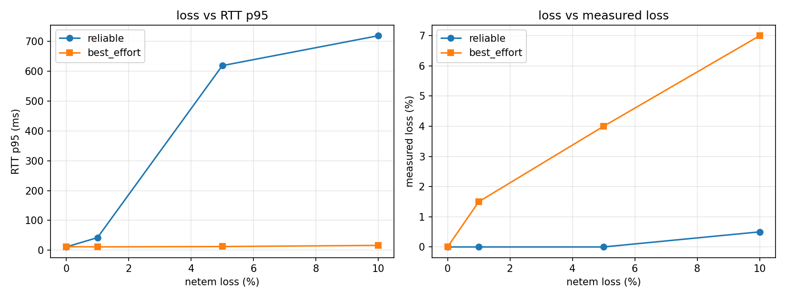

# 주제: 지연과 손실 - 손실이 있을 때 reliable과 best_effort는 어떻게 달라지는가

**예비단원 김민찬**

- 실험 환경: Ubuntu 24.04 (네이티브), Windows 11 + WSL2 Ubuntu 24.04, ROS 2 Jazzy

---

## 1. 질문

**네트워크에 손실이 생겼을 때, QoS의 reliability를 reliable로 두는 것과 best_effort로 두는 것이
RTT의 p95와 실제 도착률을 각각 어떻게 바꾸는가?**

QoS에서 reliability는 "빠진 패킷을 다시 보낼 것인가"를 정하는 설정이다.
reliable은 재전송으로 빠짐을 메우고, best_effort는 빠진 채로 넘어간다.
netem으로 지연을 구현하여 두 옵션에서 각각 지연으로 나타나는지 손실로 나타나는지를 숫자로 확인한다.

### p95

평균은 가끔 터지는 큰 지연을 가려 버리므로
로봇 제어에서 문제가 되는 값인 가장 늦게 도착한 값을 사용하여 주 지표로 삼아 측정한다.
또한 동시에 평균과 중앙값도 같이 기록해 셋을 비교한다.

### 측정할 값

| 지표 | 의미 |
|---|---|
| 측정 손실률 | 보낸 메시지 중 되돌아오지 않은 비율 |
| 평균 RTT | 돌아온 메시지의 왕복 시간 평균 |
| p50 RTT | 중앙값 — "대부분은 이 정도" |
| **p95 RTT** | **주 지표 — 느린 쪽 5%의 경계** |
| 최대 RTT | 가장 늦게 도착한 값 |

---

## 2. 예상


### 예상 1 — best_effort: 손실률은 올라가고, p95는 평평할 것

재전송이 없으므로 빠진 패킷은 그대로 사라진다.
따라서 **측정 손실률이 netem에 건 손실률을 따라 올라가고**,
살아남아 돌아온 패킷들의 RTT는 손실과 무관하므로 **p95는 거의 변하지 않을 것**이다.

### 예상 2 — reliable: 손실률은 0에 가깝고, p95는 올라갈 것

빠진 패킷을 재전송해 결국 도착시키므로 측정되는 손실률은 모든 조건에서 0%에 가까울 것이다.
대신 재전송을 기다리는 시간만큼 지연이 붙으므로,
p95가 손실률이 커질수록 함께 올라갈 것이다.

### 예상 3 — 손실 0%에서는 둘이 비슷할 것

재전송할 일이 없으면 두 설정은 같은 경로로 같은 일을 한다.
기준 조건(손실 0%)에서 두 설정의 p95는 비슷한 값이 나올 것이다.

### 예상 4 — 평균과 p95의 차이가 벌어질 것

reliable에 손실을 걸면 대부분의 패킷은 한 번에 도착하고 일부만 재전송을 거친다.
따라서 평균은 완만하게, p95는 가파르게 올라가 둘의 간격이 벌어질 것이다.

### 수치 예상

| 조건 | 측정 손실률 | p95 RTT |
|---|---|---|
| reliable, loss 0% | 0% | 한 자릿수 ms |
| reliable, loss 10% | 0%에 가까움 | 수십~수백 ms |
| best_effort, loss 0% | 0% | reliable과 비슷 |
| best_effort, loss 10% | 설정값 근처 | loss 0%일 때와 비슷 |

---

## 3. 방법

### 3-1. 실험 환경

| 항목 | 보내는 쪽 (측정) | 되돌려주는 쪽 |
|---|---|---|
| OS | Ubuntu 24.04 | Windows 11 + WSL2 Ubuntu 24.04 |
| 호스트명 | `minchan-IdeaPad-Slim-3-15ABR8` | `DESKTOP-IBS5JUS` |
| IP | `192.168.0.5` | `192.168.0.109` |
| 인터페이스 | `무선 인터넷 연결` | `이더넷 연결` |
| 역할 | `ping.py` — 발행·수신·계산 | `pong.py` — 에코 |
| netem | **여기에만 적용** | 없음 |

- 두 PC는 같은 공유기(`192.168.0.0/24`)에 붙어 있다.
- ROS 2 Jazzy, **rmw는 양쪽 모두 기본값(Fast DDS)**, `ROS_DOMAIN_ID=5`.
- `ROS_AUTOMATIC_DISCOVERY_RANGE`는 양쪽 `SUBNET`, `CYCLONEDDS_URI`는 양쪽 미설정.
- 작업 폴더는 양쪽 모두 `~/ros2_ws/src/day2`.
- 한 대의 PC는 pong을 위해 wsl로 ubuntu를 간이 구현하여 실험 진행. wsl은 기본적으로 외부 PC가 WSL 안의 노드를 볼 수 없어 Windows 11의 mirrored 모드로 해결했다.

### 3-3. 측정 전 조치 — 경로와 잡음 제거

측정값을 믿으려면 **경로가 하나여야 하고, 기준선이 깨끗해야 한다.** 따라서 다음을 손봤다.

** 와이파이 전원 절약 끄기**

연결 확인 중 **방향별로 지연이 크게 비대칭**인 것을 발견했다(3-6 참조).
Ubuntu의 무선 칩이 수신 대기 중 절전 상태로 들어가면서 AP가 패킷을 버퍼에 쥐고 있던 것이다.

```bash
sudo iw dev wlp2s0 set power_save off
```

끈 뒤 WSL → Ubuntu 지연이 **43~100ms → 1.5~2.3ms** 로 떨어졌다.
이 조치 없이 측정했다면 netem 효과가 와이파이 잡음에 묻혔을 것이다.

실험 종료 후 두 설정 모두 원래대로 되돌렸다.

### 3-4. 측정 코드

**`ping.py`** (Ubuntu) — 번호와 보낸 시각을 문자열에 실어 `/ping`으로 발행하고,
`/pong`으로 돌아온 메시지에서 번호와 시각을 꺼내 RTT를 계산한다.

**`pong.py`** (WSL) — `/ping`을 구독해 받은 메시지를 그대로 `/pong`으로 발행한다.

실험에서 고려하여 진행한 부분:

- **시계를 한쪽만 쓴다.** 보낸 시각을 메시지에 실어 보내고 돌아온 뒤 같은 PC의 `time.monotonic()`으로 뺀다. 두 PC의 시계가 달라도 RTT는 정확하다.
- **QoS를 명령행 인자로 받는다.** 파일을 고치지 않고 `reliable` / `best_effort`를 바꿔 실행하므로, 한쪽만 바꿔 매칭이 깨지는 실수를 줄인다. 양쪽에 같은 값을 준다.
- **매칭이 끝난 뒤 발행을 시작한다.** `/ping`의 구독자 수와 `/pong`의 발행자 수가 모두 1 이상이 될 때까지 기다리고, 1초 안정화한 뒤 보낸다. (이 처리가 없어서 1차 측정이 실패했다 — 3-6 참조)
- **마지막 발행 후 3초 더 기다린다.** 재전송으로 늦게 도착하는 답을 놓치지 않기 위해서다. 이 시간이 없으면 reliable의 **지연이 손실로 잘못 집계된다.**
- **돌아오지 않은 번호가 곧 손실이다.** 기록된 RTT 개수와 N의 차이로 센다.

측정 조건: **N = 200, 발행 주기 10 Hz** (조건당 20초 발행 + 3초 대기).

### 3-5. 실행한 조건

`netem loss` 4단계 × QoS 2가지 = **8회**.
`delay`는 걸지 않고 **loss만 변수로** 썼다. 지연까지 같이 걸면 p95 증가분이 netem 때문인지 재전송 때문인지 구분할 수 없기 때문이다.

QoS를 바꾸려면 양쪽 노드를 모두 재시작해야 하므로, **QoS를 고정하고 loss를 쓸어가는 순서**로 돌렸다.

```
pong.py reliable    실행 → loss 0 → 1 → 5 → 10
pong.py best_effort 실행 → loss 0 → 1 → 5 → 10
```

netem을 걸 인터페이스는 추측하지 않고 명령으로 확정했다.

```bash
$ ip route get 192.168.0.109
192.168.0.109 dev wlp2s0 src 192.168.0.5 uid 1000
```

조건별 실행은 `run_all.sh`로 묶었다. 각 조건마다 `tc`를 걸고 → `tc qdisc show`로 확인하고 → 측정하고 → 결과와 `tc` 출력을 `evidence/`에 저장한다.

```bash
# [W] 되돌려주는 쪽
ROS_DOMAIN_ID=5 python3 pong.py reliable

# [U] 보내고 재는 쪽
./run_all.sh wlp2s0 reliable
./run_all.sh wlp2s0 best_effort
```

### 3-6. 1차 측정 실패와 수정

**첫 측정에서 기준 조건(netem 없음)의 reliable이 9.5%를 잃었다.**
reliable은 재전송하므로 손실이 0에 가까워야 하는데 그렇지 않았다.

| netem | 1차 측정 손실률 (reliable) |
|---|---|
| 0% | **9.5%** |
| 1% | 12.5% |
| 5% | 15.5% |
| 10% | **3.0%** |

`loss 10%`에서 손실률이 **오히려 가장 낮게** 나온 것이 결정적이었다.
네트워크 손실이라면 설정값을 따라 올라가야 하므로, 이것은 네트워크가 아니라 **측정 쪽 문제**다.

원인은 **발행 시작 시점**이었다. `ping.py`가 노드를 만들자마자 보내기 시작하는데,
그 시점에는 아직 상대와 매칭이 끝나지 않았다. 매칭 전에 발행한 메시지는
durability가 VOLATILE이므로 그대로 사라진다.
10 Hz에서 19개 손실 ≈ 1.9초이고, 실제 매칭에 1.0~1.6초가 걸렸으므로 수치가 맞아떨어진다.

**수정:** 매칭 완료를 기다린 뒤 1초 안정화하고 발행을 시작하도록 고쳤다.
수정 후 기준 조건의 손실은 **0.0%** 가 됐다.

```
[INFO] [ping]: ping start  qos=reliable  tag=loss0  N=200  (매칭 대기)
[INFO] [ping]: 매칭 완료 (1.0s) — 안정화
[INFO] [ping]: 발행 시작
[loss0] qos=reliable  n=200/200  loss=0.0%  ...
```

1차 측정 결과는 `evidence/v1_startup_loss/`에 남겨 두었다.

---

## 4. 증거

### 4-1. 측정 결과표

| QoS | netem 손실 | 도착 | 측정 손실률 | 평균 | p50 | **p95** | 최대 |
|---|---|---|---|---|---|---|---|
| reliable | 0% | 200/200 | 0.00% | 4.56ms | 3.31ms | **11.10ms** | 24.89ms |
| reliable | 1% | 200/200 | 0.00% | 20.20ms | 3.20ms | **42.38ms** | 523.29ms |
| reliable | 5% | 200/200 | 0.00% | 90.32ms | 4.03ms | **619.18ms** | 924.66ms |
| reliable | 10% | 199/200 | 0.50% | 181.32ms | 7.97ms | **719.44ms** | 1005.83ms |
| best_effort | 0% | 200/200 | 0.00% | 5.30ms | 4.06ms | **12.03ms** | 22.81ms |
| best_effort | 1% | 197/200 | 1.50% | 5.47ms | 4.11ms | **11.38ms** | 74.16ms |
| best_effort | 5% | 192/200 | 4.00% | 4.84ms | 3.78ms | **12.43ms** | 20.14ms |
| best_effort | 10% | 186/200 | 7.00% | 6.08ms | 4.18ms | **16.30ms** | 70.45ms |

원본: `results.csv`

### 4-2. 그래프



- **왼쪽 (손실률 대 p95)** — reliable은 가파르게 올라가고, best_effort는 바닥에 평평하게 깔린다.
- **오른쪽 (손실률 대 측정 손실률)** — 정확히 반대로, best_effort는 대각선으로 올라가고 reliable은 0에 붙어 있다.

두 그래프가 교차하는 모양이 이 실험의 결론을 그대로 보여준다.

### 4-3. 연결 확인

**양쪽 IP (같은 대역)**

```
# Ubuntu
wlp2s0           UP             192.168.0.5/24 ...
# WSL (mirrored 적용 후)
eth1             UP             192.168.0.109/24 ...
```


**전원 절약을 끄기 전 — WSL → Ubuntu**

```
64 bytes from 192.168.0.5: icmp_seq=1 ttl=64 time=43.4 ms
64 bytes from 192.168.0.5: icmp_seq=2 ttl=64 time=57.3 ms
64 bytes from 192.168.0.5: icmp_seq=3 ttl=64 time=73.8 ms
64 bytes from 192.168.0.5: icmp_seq=4 ttl=64 time=100 ms
rtt min/avg/max/mdev = 43.365/68.684/100.282/21.179 ms
```

**끈 뒤 — 같은 방향**

```
rtt min/avg/max/mdev = 1.561/1.915/2.315/0.258 ms
```

평균 68.7ms → 1.9ms, 흔들림(mdev) 21.2ms → 0.26ms.


**발견 확인**

```bash
$ ROS_DOMAIN_ID=5 ros2 node list --spin-time 5
/pong
```

기본 Fast DDS 멀티캐스트만으로 두 PC가 서로를 발견했다. Cyclone이나 Peers 설정은 쓰지 않았다.


### 4-4. reliable 4조건 측정

각 측정 직전의 `tc qdisc show dev wlp2s0` 출력을 함께 남겼다.
**조건이 실제로 걸린 상태에서 잰 값**임을 보이기 위해서다.

```
=== reliable / netem loss 0% ===
qdisc noqueue 0: root refcnt 2
[INFO] [ping]: 매칭 완료 (1.0s) — 안정화
[loss0] qos=reliable  n=200/200  loss=0.0%  mean=4.6ms  p50=3.3ms  p95=11.1ms  max=24.9ms

=== reliable / netem loss 1% ===
qdisc netem 8002: root refcnt 2 limit 1000 loss 1%
[loss1] qos=reliable  n=200/200  loss=0.0%  mean=20.2ms  p50=3.2ms  p95=42.4ms  max=523.3ms

=== reliable / netem loss 5% ===
qdisc netem 8002: root refcnt 2 limit 1000 loss 5%
[loss5] qos=reliable  n=200/200  loss=0.0%  mean=90.3ms  p50=4.0ms  p95=619.2ms  max=924.7ms

=== reliable / netem loss 10% ===
qdisc netem 8002: root refcnt 2 limit 1000 loss 10%
[loss10] qos=reliable  n=199/200  loss=0.5%  mean=181.3ms  p50=8.0ms  p95=719.4ms  max=1005.8ms

=== netem 해제 ===
qdisc noqueue 0: root refcnt 2
```


### 4-5. best_effort 4조건 측정

QoS를 바꾸려면 양쪽 노드를 모두 재시작해야 한다.
WSL의 `pong.py`를 `best_effort`로 다시 띄운 뒤 같은 조건을 반복했다.


```
=== best_effort / netem loss 0% ===
qdisc noqueue 0: root refcnt 2
[loss0] qos=best_effort  n=200/200  loss=0.0%  mean=5.3ms  p50=4.1ms  p95=12.0ms  max=22.8ms

=== best_effort / netem loss 1% ===
qdisc netem 8003: root refcnt 2 limit 1000 loss 1%
[loss1] qos=best_effort  n=197/200  loss=1.5%  mean=5.5ms  p50=4.1ms  p95=11.4ms  max=74.2ms

=== best_effort / netem loss 5% ===
qdisc netem 8003: root refcnt 2 limit 1000 loss 5%
[loss5] qos=best_effort  n=192/200  loss=4.0%  mean=4.8ms  p50=3.8ms  p95=12.4ms  max=20.1ms

=== best_effort / netem loss 10% ===
qdisc netem 8003: root refcnt 2 limit 1000 loss 10%
[loss10] qos=best_effort  n=186/200  loss=7.0%  mean=6.1ms  p50=4.2ms  p95=16.3ms  max=70.4ms

=== netem 해제 ===
qdisc noqueue 0: root refcnt 2
```


### 4-6. 뒷정리

실험이 끝난 뒤 netem을 해제하고, 측정을 위해 바꿨던 설정을 되돌렸다.

```bash
sudo tc qdisc del dev wlp2s0 root
sudo iw dev wlp2s0 set power_save on
sudo tailscale up
```


### 4-7. 증거 파일

**스크린샷**

| 파일 | 내용 | 본문 위치 |
|---|---|---|
| `evidence/shot1_ip.png` | 양쪽 `ip -br addr` — 같은 대역 | 4-3 |
| `evidence/shot2_ping_powersave.png` | 전원 절약 끄기 전후 ping 비교 | 4-3 |
| `evidence/shot3_discovery.png` | `ros2 node list` 에 `/pong` | 4-3 |
| `evidence/shot4_run_reliable.png` | **`./run_all.sh wlp2s0 reliable` 전체 출력** | 4-4 |
| `evidence/shot5_pong_best_effort.png` | `pong ready qos=best_effort` | 4-5 |
| `evidence/shot6_run_best_effort.png` | **`./run_all.sh wlp2s0 best_effort` 전체 출력** | 4-5 |
| `evidence/shot7_cleanup.png` | netem 해제 · 설정 복구 | 4-6 |
| `evidence/graph.png` | 그래프 2개 | 4-2 |

**출력 파일**

| 파일 | 내용 |
|---|---|
| `results.csv` | 측정값 전체 (머리줄 + 8줄) |
| `evidence/00_ip_ubuntu.txt`, `00_ip_wsl.txt` | 양쪽 IP |
| `evidence/00_env_ubuntu.txt`, `00_env_wsl.txt` | 양쪽 ROS 환경변수 |
| `evidence/01_ping_u2w.txt`, `01_ping_w2u.txt` | 양방향 ping (전원 절약 끄기 전) |
| `evidence/01_ping_w2u_after_powersave.txt` | 끈 뒤 |
| `evidence/02_powersave_off.txt` | `Power save: off` |
| `evidence/02_route.txt` | netem을 건 인터페이스 확정 |
| `evidence/02_node_list.txt` | 상대 노드 발견 |
| `evidence/tc_loss*.txt` | 조건별 netem 적용 상태 |
| `evidence/run_*_loss*.txt` | 측정 8건 |
| `evidence/tc_removed.txt` | netem 해제 |
| `evidence/terminal_U1.log` | 메인 터미널 전체 기록 |
| `evidence/v1_startup_loss/` | 1차 측정(실패) 결과 |
| `ping.py`, `pong.py`, `plot.py`, `run_all.sh` | 실험 코드 |

---

## 5. 결론

### 5-1. 질문에 대한 답

**reliable은 손실을 지연으로 바꾸고, best_effort는 지연을 손실로 바꾼다.**

같은 10% 손실 조건에서 두 설정은 정반대의 대가를 치렀다.

| | 측정 손실률 | p95 RTT |
|---|---|---|
| reliable | 0.50% | 719.44ms |
| best_effort | 7.00% | 16.30ms |

reliable은 **데이터를 거의 하나도 잃지 않는 대신 p95가 기준의 65배**가 됐고,
best_effort는 **p95를 기준의 1.4배로 지키는 대신 7%를 버렸다.**

손실률을 지키느냐 지연을 지키느냐는 양립하지 않으며, QoS는 그 둘 중
**무엇을 포기할지 고르는 스위치**였다.

### 5-2. 예상별 적중 여부

**예상 ① — best_effort: 손실률은 올라가고 p95는 평평할 것 → 맞음**

측정 손실률 0 → 1.5 → 4.0 → 7.0%로 올라가는 동안
p95는 12.03 → 11.38 → 12.43 → 16.30ms로 거의 변하지 않았다.
가장 가혹한 조건에서도 기준 대비 1.4배에 그쳤다.

**예상 ② — reliable: 손실률은 0에 가깝고 p95는 올라갈 것 → 맞음**

측정 손실률은 0.00 / 0.00 / 0.00 / 0.50%로 전 조건에서 0에 붙어 있었고,
p95는 11.10 → 42.38 → 619.18 → 719.44ms로 **64.8배** 커졌다.
10% 조건에서 남은 0.5%(1개)는 마지막 발행분의 재전송이 3초 대기 안에
들어오지 못한 것으로 보인다.

**예상 ③ — 손실 0%에서는 둘이 비슷할 것 → 맞음**

p95가 11.10ms(reliable) 대 12.03ms(best_effort)로 차이가 0.93ms였다.
재전송할 일이 없으면 두 설정이 같은 일을 한다는 것이 확인됐고,
이후 조건에서 벌어진 차이가 **손실 때문이지 설정 자체의 오버헤드 때문이 아님**을 보장한다.

**예상 ④ — 평균과 p95가 벌어질 것 → 맞음, 다만 p50까지 보니 더 분명했다**

reliable에서 세 지표의 증가 배율이 크게 달랐다.

| 지표 | 0% → 10% | 배율 |
|---|---|---|
| p50 | 3.31 → 7.97ms | 2.4배 |
| 평균 | 4.56 → 181.32ms | 39.8배 |
| **p95** | 11.10 → 719.44ms | **64.8배** |

**p50이 거의 움직이지 않았다**는 것이 핵심이다.
대부분의 메시지는 손실과 무관하게 한 번에 도착했고, 재전송을 겪은 소수만
수백 ms를 치렀다. 그 소수가 평균을 39배로 끌어올리고 p95를 65배로 밀어올린 것이다.

평균만 봤다면 `loss 1%` 조건의 20.2ms를 "쓸 만하다"고 판단했겠지만,
같은 조건의 최대값은 **523ms**였다. p95를 지표로 삼은 이유가 여기서 확인됐다.

### 5-3. 측정 손실률이 설정값보다 낮은 이유

best_effort의 측정 손실률은 netem 설정값보다 낮게 나왔다.

| netem | 측정 | 잃은 개수 |
|---|---|---|
| 1% | 1.5% | 3/200 |
| 5% | 4.0% | 8/200 |
| 10% | 7.0% | 14/200 |

두 가지가 작용한 것으로 본다.

1. **netem은 나가는 패킷에만 걸린다.** 왕복 중 Ubuntu → WSL 방향만 손실을 겪고,
   돌아오는 WSL → Ubuntu 방향은 영향을 받지 않는다.
2. **드롭이 `/ping` 메시지에만 떨어지는 것이 아니다.** 같은 인터페이스로 나가는
   DDS 발견 패킷 등도 같은 확률로 버려지므로, 실제로 측정 대상에 떨어지는 비율은
   설정값보다 낮아진다.

표본 변동도 있다. n=200, p=0.1이면 기대 20개에 표준편차가 약 4.2개이므로
14개는 설명 가능한 범위 안이다.

### 5-4. 그래서 무엇을 쓸 것인가

이 결과를 로봇 데이터에 대입하면 판단이 갈린다.

| 데이터 | 선택 | 이유 |
|---|---|---|
| 센서 스트림 (카메라, LiDAR, odometry) | **best_effort** | 한 프레임 늦게 오는 것보다 버리고 다음 것을 받는 게 낫다. 손실 10%에서도 p95가 16ms로 유지됐다 |
| 명령·설정·상태 (목표 위치, 파라미터, 비상정지) | **reliable** | 하나라도 빠지면 안 된다. 다만 **지연이 수백 ms까지 튈 수 있다**는 것을 설계에 반영해야 한다 |

reliable을 고르는 것은 "안전한 선택"이 아니라 **지연 예산을 내주는 선택**이다.
손실 10% 구간에서 p95가 719ms였으므로, 100ms 주기 제어 루프에 reliable을 쓰면
실시간성이 무너진다. 이 실험의 가장 실무적인 교훈이다.

---

## 6. 아직 모르는 것

- **reliable의 p95가 619ms와 719ms에서 멈춘 이유.**
  loss 5%와 10%는 손실이 두 배 차이인데 p95는 619 → 719ms로 16%만 늘었고,
  최대값도 924.7 → 1005.8ms로 비슷했다. 재전송 타이머나 heartbeat 주기 같은
  **상한에 걸린 것**으로 보이지만, Fast DDS의 어떤 값이 이 천장을 만드는지는 확인하지 못했다.
  `Verbosity`를 올려 재전송 로그를 보면 알 수 있을 것 같다.

- **기준 조건의 p95가 11~12ms인 이유.**
  같은 구간의 `ping` RTT는 평균 1.9ms, 최대 2.3ms였는데
  DDS를 통하면 p95가 11ms로 다섯 배 넘게 커졌다.
  DDS 스택 처리 시간인지, 10 Hz 발행 타이머와 수신 콜백의 타이밍이 어긋나서인지 구분하지 못했다.

- **best_effort `loss 1%` 조건에서 측정 손실률이 설정값보다 높게(1.5%) 나온 것.**
  3/200이라 표본 변동으로 설명 가능한 범위지만, 같은 조건을 여러 번 돌려
  평균을 내지 않아 단정할 수 없다. 조건당 3회씩 반복했어야 했다.

- **reliable `loss 10%`에 남은 0.5%(1개)의 정체.**
  마지막 발행분의 재전송이 3초 대기 안에 못 들어온 것으로 추정했지만,
  어느 번호가 빠졌는지 기록하지 않아 확인할 수 없었다.
  빠진 번호를 출력하도록 고쳤다면 바로 알 수 있었을 것이다.

- **와이파이 전원 절약이 왜 한 방향에만 영향을 줬는지.**
  Ubuntu가 보낼 때는 2~5ms였는데 받을 때만 43~100ms였다.
  수신 대기 중 절전 상태에서 AP가 패킷을 버퍼링하는 것으로 이해했지만,
  지연이 43 → 57 → 74 → 100ms로 **점점 늘어난** 이유는 설명하지 못하겠다.

---

## 7. 실패한 시도

| # | 시도한 것 | 결과 | 어떻게 알았나 / 어떻게 고쳤나 |
|---|---|---|---|
| 1 | 매칭을 기다리지 않고 바로 발행 | 기준 조건에서 reliable이 **9.5% 손실** | `loss 10%`에서 손실률이 **3.0%로 더 낮게** 나온 것이 단서. 네트워크 손실이면 설정값을 따라가야 한다. 매칭 대기 + 1초 안정화를 넣어 0.0%로 고쳤다 |
| 2 | `ping` 명령 실행 | `socket: 명령을 허용하지 않음` | 바이너리에 `cap_net_raw` 권한이 없었다. `sudo setcap cap_net_raw+p /usr/bin/ping` |
| 3 | 전원 절약을 켠 채로 연결 확인 | WSL → Ubuntu 지연 **43~100ms**, 반대 방향은 2~5ms | 방향별 비대칭이 단서였다. 증상은 WSL 터미널에 나타났지만 원인은 **받는 쪽 Ubuntu**였다. `iw dev wlp2s0 set power_save off` |
| 4 | 이틀 전 적어 둔 IP로 접속 시도 | 주소가 바뀌어 있었다 (`172.100.7.152` → `192.168.0.5`) | 공유기에서 받는 주소는 세션마다 달라진다. 실험 시작 때마다 `ip -br addr`로 다시 읽기로 했다 |
| 5 | Tailscale을 켜 둔 채 측정 시도 | (측정 전 차단) | 양쪽에 `100.x` 주소가 떠 있어 DDS가 LAN과 VPN 중 어느 경로를 쓸지 불확실했다. 실험 동안 내려 경로를 하나로 고정했다 |

1번은 **이 실험에서 가장 값진 실패**였다.
고치지 않았다면 "reliable도 10% 가까이 잃는다"는 틀린 결론을 냈을 것이고,
그 결론이 그럴듯해 보였을 것이다. 조건을 바꿨는데 수치가 **반대 방향으로 움직인 것**이
측정 자체를 의심하게 만든 신호였다.
